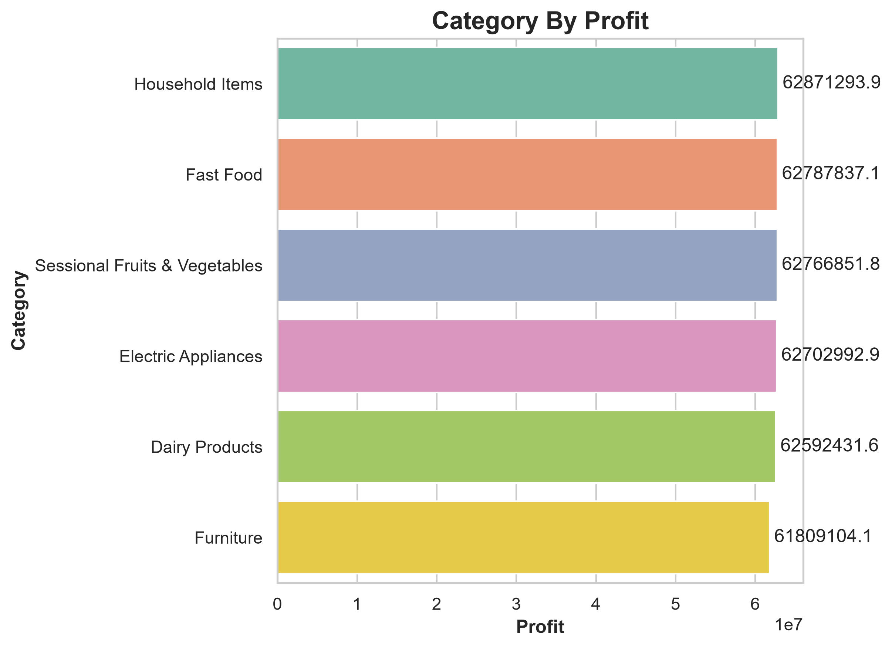
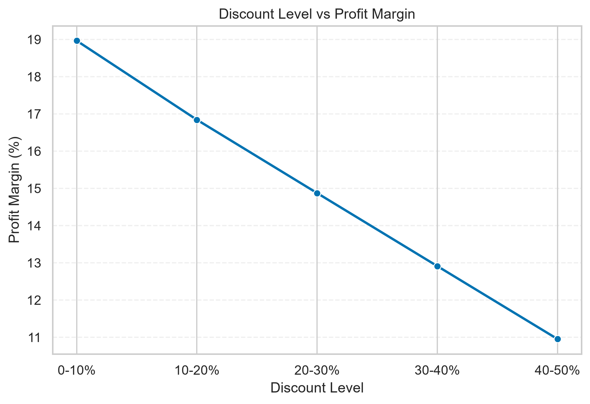
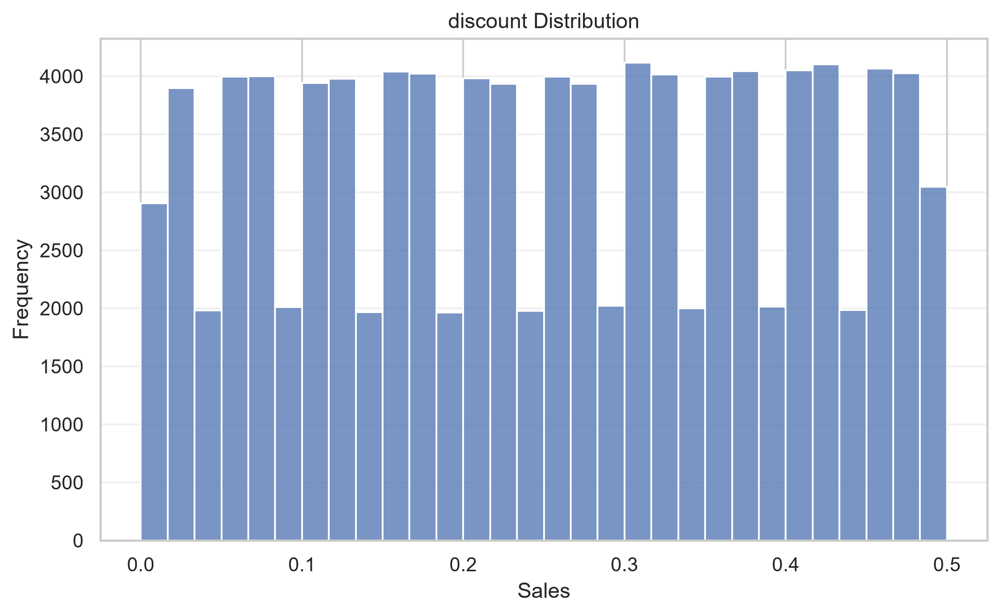

# Retail Sales & Profitability Analysis (2019–2023)

## Project Overview

An exploratory data analysis of a 100,000-row retail sales dataset covering Indian states, outlet types, product categories and customer segments. The project cleans the data, builds business KPIs and visualises where sales and profit come from and how discounting affects profit margin.

- **Dataset:** `2Store_Sales_Dataset.csv` (100,000 rows × 25 columns)
- **Period:** 2019–2023
- **Categories (6):** Fast Food, Dairy Products, Seasonal Fruits & Vegetables, Household Items, Electric Appliances, Furniture
- **Sub-categories (24):** e.g. Burgers, Pizzas, Milk, Carrots, Mops, Microwaves, Sofas, Chairs

## Problem Statement and Objectives

**Problem Statement:** The business needs to understand which products drive sales and profit, and whether its discount strategy is hurting profitability.

**Objectives**
- Clean and prepare the raw retail data for analysis
- Engineer features such as profit margin, discount bands, age groups and shipping days
- Calculate key business KPIs
- Identify top and bottom performing categories and sub-categories
- Analyse the relationship between discount level and profit margin
- Explore performance by state, city type, outlet type and year
- Provide data-driven business recommendations

## Workflow

1. Load the dataset with Pandas
2. Drop unneeded columns and standardise column names
3. Convert date columns to datetime
4. Engineer new features
5. Calculate KPIs
6. Perform EDA and build visualisations
7. Draw insights and recommendations

## Data Cleaning and Preprocessing

- Dropped columns not needed for analysis: `Customer Name`, `Last Name`, `Year`, `Country`, `Postal Code`, `Product Name`
- Standardised column names (lowercase, underscores)
- Converted `Date of Birth`, `Sales Date`, `Order Date` and `Ship Date` to datetime (mixed formats, day-first)
- Created new features:
  - `order_year`, `order_month`, `order_quarter`
  - `age` and `age_group` (under-18, 18-25, 26-35, 36-45, 46-60, 60+)
  - `shipping_days` (ship date − order date)
  - `profit_margin` (profit / sales × 100)
  - `discount_band` (0-10%, 10-20%, 20-30%, 30-40%, 40-50%)
  - `sales_band` (low / medium / high)

## Exploratory Data Analysis

- Sales distribution and profit boxplot
- Discount distribution
- Category by sales and by profit
- Sub-category by sales and by profit
- Discount level vs profit margin
- Discount vs profit margin by state and sub-category
- Yearly sales, profit and margin trends
- Sales by state, city type and outlet type

## Key Findings

| KPI | Value |
|---|---|
| Total Sales | ₹250.84 Cr |
| Total Profit | ₹37.55 Cr |
| Overall Profit Margin | 14.97% |
| Average Shipping Days | 3.99 |
| Average Discount | 25% |

- **Top category by sales:** Seasonal Fruits & Vegetables (₹41.99 Cr); lowest is Furniture (₹41.40 Cr). Sales are very evenly spread across categories.
- **Top category by profit:** Household Items (₹6.29 Cr); lowest is Furniture (₹6.18 Cr).
- **Top sub-category:** Mops lead in both sales (₹10.96 Cr) and profit (₹1.64 Cr), followed by Carrots and Microwaves.
- **Weakest sub-category:** Chairs, with the lowest sales (₹9.95 Cr) and profit (₹1.49 Cr).
- **Discounts hurt margin:** profit margin falls from about 19% at 0-10% discount to about 11% at 40-50%.
- **Heavy discounting is common:** discounts are spread almost uniformly between 0% and 50%.

**Recommendations**
1. Keep investing in high-performing sub-categories.
2. Review and cap deep discounts to protect margin.
3. Improve the performance of low-performing sub-categories such as Chairs.
4. Focus on profitable customer segments and locations.
5. Monitor yearly sales and profit trends.

## Visualizations 

### Category by Sales

### Category by Profit

### Sub-Category by Profit

### Discount Level vs Profit Margin

### Discount Distribution

## Tools and Technologies 👨🏼‍💻

- Python
- Pandas
- NumPy
- Matplotlib
- Seaborn
- Jupyter Notebook

## Project Files 🗃️

- Jupyter Notebook: [Retail Sales Profitability Analysis](Retail_Sales_Profitability_Analysis.ipynb)

- PDF Report: [View PDF Report](Retail_Sales_Profitability_Analysis.ipynb%20-%20Colab.pdf)

## Author 🙎🏼‍♂️

**Subhakar**  
[subhakarb2004@gmail.com](mailto:subhakarb2004@gmail.com)
